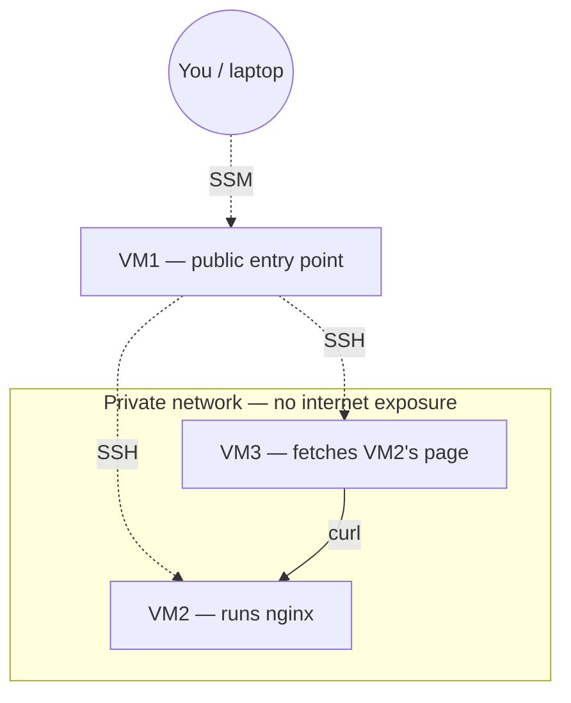
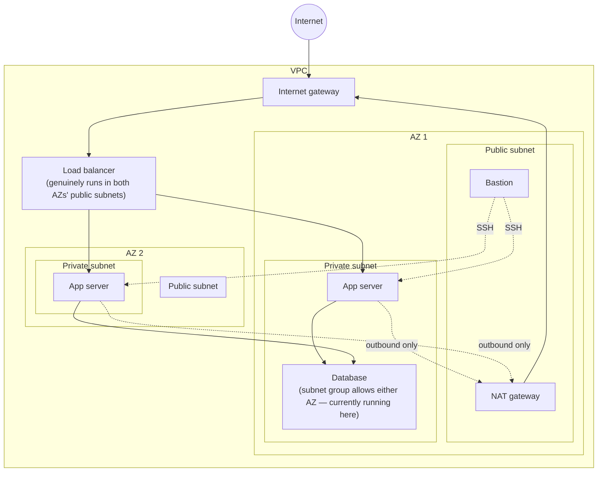
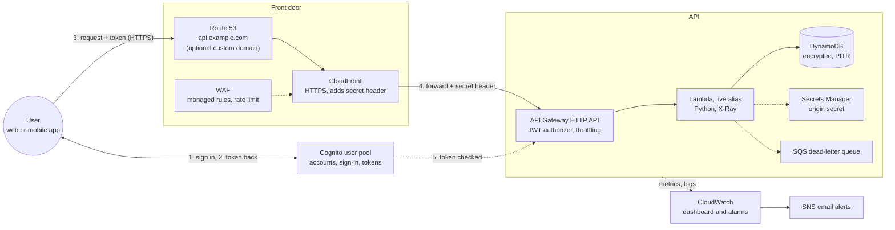
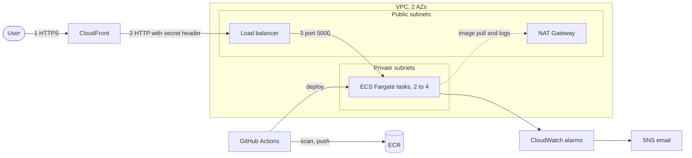
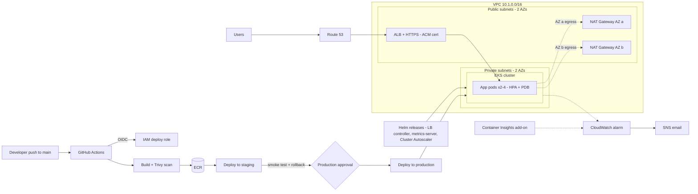
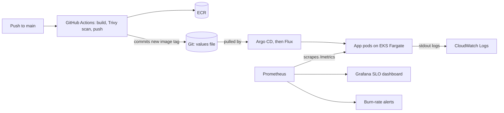

# Cloud DevOps Portfolio

Hands-on cloud infrastructure projects: AWS, Terraform, Kubernetes, CI/CD.

## Projects

### Foundations

| # | Stage | Description | Status |
|---|---|---|---|
| [0](00-fundamentals) | Gate check | Public and private VMs, SSM access with no open SSH, and a break/fix exercise | Complete |
| [1](01-aws-cli) | AWS CLI two-tier | A two-tier AWS app, built by hand and then by script | Complete |

### Infrastructure as Code

| # | Stage | Description | Status |
|---|---|---|---|
| [2](02-terraform) | Terraform platform | The same architecture as code, with remote state and drift detection | Complete |
| [2b](02b-serverless-terraform) | Serverless API (Terraform) | A production-style serverless API with sign-in, a protected front door, alerting and a gated three-environment pipeline | Complete |

### CI/CD

| # | Stage | Description | Status |
|---|---|---|---|
| [3](03-cicd) | CI/CD pipeline (GitHub Actions) | Plan on pull request, apply on merge, deploying the Stage 2 infrastructure with no stored keys | Complete |
| [3b](03b-jenkins) | CI/CD pipeline (Jenkins) | The same pipeline on self-hosted Jenkins, to compare effort | Complete |

### Containers

| # | Stage | Description | Status |
|---|---|---|---|
| [4](04-containers) | Containers & ECS | A container on ECS Fargate behind HTTPS, deployed through staging with scanning and rollback | Complete |

### Kubernetes

| # | Stage | Description | Status |
|---|---|---|---|
| [5](05-kubernetes-nodes) | Kubernetes (node-based) | The app on EKS with self-healing and autoscaling, deployed with scanning and rollback | Complete |
| [6](06-kubernetes-fargate-observability) | Kubernetes on Fargate with observability | EKS on Fargate, with centralised logging, Prometheus and Grafana, SLOs with error budgets, and GitOps deploys with Argo CD and Flux | Complete |

### Configuration management and monitoring

| # | Stage | Description | Status |
|---|---|---|---|
| [7](07-server-configuration) | Linux servers with Ansible | Linux servers on EC2 built with CloudFormation and configured with Ansible, running PostgreSQL, monitored by Zabbix, and deployed through GitLab CI | Complete |

### Security

| # | Stage | Description | Status |
|---|---|---|---|
| [8](08-security-capstone) | Security review | Checkov and gitleaks scans in CI, plus CloudTrail, EventBridge alerts and IAM Access Analyzer | Complete |

## Gate check — write-up

**Goal:** build a public entry point and two fully isolated private machines, prove they can communicate internally, and recover from an induced failure using logs alone.

**What was built:**
- VM1 (public): the only machine with a public IP. Accessed exclusively via AWS SSM Session Manager — no SSH port ever opened to the internet.
- VM2 & VM3 (private): no public IP at all. SSH access restricted to VM1's private IP only, via security group rules.

**Real issue hit and resolved:**
- **Issue 1 — SSH to VM1 blocked:** initial SSH attempts to VM1 timed out consistently. Diagnosed methodically — verified the security group, route table, and instance health were all correct, then ruled out the network by testing over a different connection entirely. Isolated the cause to the laptop's own device-level policy blocking outbound SSH, regardless of network. Resolved by switching to SSM Session Manager, which uses HTTPS instead of SSH — arguably the more production-appropriate choice anyway, since it requires no open inbound port at all.

- **Issue 2 — VM2 had no path to install packages:** package installs on VM2 failed with repository timeout errors. Root cause: a fully private subnet has no route to the internet by default, even though it must also stay unreachable from outside. Resolved by adding a NAT Gateway and routing the private subnet's outbound traffic through it — giving VM2 and VM3 outbound-only internet access with zero inbound exposure.

**Break/fix cycle:** stopped nginx on VM2 deliberately, diagnosed using `systemctl status`, `journalctl`, and `ss -tlnp` as if walking in cold, restarted it, and verified the fix from VM3 — the actual dependent machine — rather than from VM2 itself.

**Files:** see `00-fundamentals/` for setup scripts and the architecture diagram. `build-log.md` in particular documents the full connection setup, both key-related bugs, and the security group fix that let VM3 reach VM2 — details not captured in the scripts themselves.

## Stage 1 — Manual + CLI-Scripted Two-Tier Architecture

**Goal:** build a public ALB → private Auto Scaling Group → private RDS database, across 2 AZs, with a bastion host as the sole SSH entry point — first manually in the console, then rebuilt entirely from an AWS CLI script.

**What was built:** custom VPC, 4 subnets (2 public, 2 private) across 2 AZs, IGW + NAT Gateway, layered security groups (ALB → app → database, plus bastion), ALB with target group and Auto Scaling Group, RDS MySQL database (private only), and a bastion host — built once by hand, then torn down and rebuilt identically via a one-shot AWS CLI script.

**Verified end to end:** laptop → bastion → app server → database, confirmed working on both the manual and CLI-rebuilt versions.

**Real bugs hit and fixed:** an EC2 key pair got recreated under the same name but different underlying key material, causing persistent "Permission denied" errors; resolved by generating a fresh, dedicated key pair. The CLI-scripted security groups initially omitted the bastion→app-server SSH rule present in the manual build; found via a connection timeout, fixed by adding the missing rule.

**Torn down after verification** to stop billing — both the manual and CLI-built copies.

**Files:** see `01-aws-cli/deploy.sh` for the full one-shot rebuild script.

### Design decisions

- **Two-tier layout.** The web tier is separated from the database tier so each can be secured and scaled on its own.
- **Built by hand and with the CLI first.** Doing it manually shows what each AWS service does before any automation hides it.

## Stage 2 — Infrastructure as Code (Terraform)

**Goal:** rebuild Stage 1's entire architecture declaratively using Terraform, with remote state, and prove that infrastructure defined in code remains the source of truth even after manual changes (drift detection).

**What was built:** the full Stage 1 architecture (VPC, 4 subnets across 2 AZs, IGW, NAT Gateway, route tables, 4 security groups, launch template, ALB, target group, listener, Auto Scaling Group, RDS database, bastion host) — all defined in `main.tf` and created via `terraform apply`.

**Remote state:** state stored in an S3 bucket with S3-native lockfile locking (`use_lockfile`), instead of a local file — set up before any real infrastructure was written, so it was a habit from the first resource onward.

**Secrets handling:** the database password is supplied via a Terraform variable (`var.db_password`), with the real value kept in `terraform.tfvars` — excluded from version control via `.gitignore` — rather than hardcoded into the pushed configuration.

**Real bug diagnosed and fixed:** after building the bastion, hopping from it into the private app servers timed out despite every inbound rule, key, NACL, and instance health check confirming correct. Ruled out each layer systematically before finding the actual cause: the bastion's *outbound* security group rule had been scoped to a single stale IP address instead of allowing all outbound traffic — meaning the bastion could receive connections but not initiate any. Fixed by correcting the egress rule to `0.0.0.0/0`, re-applying, and reconfirming the full chain.

**Drift detection:** manually edited a security group rule's description directly in the AWS console, then ran `terraform plan`, which correctly detected the change as drift. Ran `terraform apply` to revert AWS back to match the Terraform configuration — confirming code, not console state, is the source of truth.

**Monitoring:** added a CloudWatch alarm on the Auto Scaling Group that fires when average CPU stays above 80% for 10 minutes, with an SNS email notification, all defined in Terraform.

**Verified end to end:** laptop → bastion → app server → database, successfully connected via the Terraform-built infrastructure.

**Files:** see `02-terraform/main.tf` and `02-terraform/variables.tf` for the full configuration.

### Design decisions

- **Terraform instead of console clicks.** The Stage 1 architecture is described in code, so it is repeatable, reviewable and easy to destroy.
- **Remote S3 state.** State is stored centrally instead of on one laptop.

## Stage 2b — Serverless API; Terraform (production design)

**Goal:** build a serverless API the way a production team would run it: sign-in, a protected front door, secrets handling, alerting, three environments, and a pipeline that tests the API the way a user reaches it and rolls a bad release back.

**Status:** deployed live to dev and staging through the pipeline, verified through CloudFront, then destroyed. Production was gated by an approval and rejected on purpose.

**What was built:** a serverless API (Lambda, API Gateway, DynamoDB) with Cognito sign-in. API Gateway rejects requests without a valid token (401). Lambda runs from a versioned `live` alias with a least-privilege IAM role and an SQS dead-letter queue. X-Ray tracing, with the X-Ray SDK bundled into the package, records each DynamoDB and Secrets Manager call as a timed step. DynamoDB has encryption and point-in-time recovery, with deletion protection in prod. The handler validates input, takes the owner from the verified token (never the request body), and only lets a user read or overwrite their own items. In front sit CloudFront (HTTPS) and WAF (managed rules and a rate limit); CloudFront adds a secret header kept in Secrets Manager, and Lambda refuses requests without it, so API Gateway cannot be called around the front door. Route 53 and an ACM certificate are optional and only used when a custom domain is set. Seven CloudWatch alarms send email through SNS, and a CloudWatch dashboard shows the whole request path in one place: API Gateway requests, errors and latency, Lambda errors and duration, DynamoDB throttles, the dead-letter queue, and CloudFront and WAF traffic. The whole front door sits behind an `enable_edge` variable (default `true`) so it can be switched off in an account where CloudFront is not available.

**Environments:** `dev`, `staging` and `prod` use the same code with `-var="environment=..."` and separate remote state in S3 (`serverless/<env>/terraform.tfstate`, `use_lockfile` locking). Prod adds deletion protection on the table and the user pool and a 30-day secret recovery window.

**CI/CD pipeline** (`.github/workflows/serverless.yml`, OIDC, no stored keys): pull requests run a `checks` job (format, Python and shell syntax, `terraform validate`) that needs no AWS access, then a `plan` against dev under a read-only role. A merge to `main` deploys dev, then staging, then prod, one at a time, and prod waits for a required reviewer. Deploys run under a separate scoped role that can only touch `serverless-*` resources and can only be assumed by jobs in the dev, staging and production environments. Both roles are defined in `02b-serverless-terraform/ci-roles/` with their own state, so destroying an environment never removes the pipeline's access, and the deploy role cannot edit itself. After each apply a smoke test creates a temporary Cognito user and checks that a call without a token gets 401, a POST saves an item and a GET returns it, then sends a burst of 1,500 requests and checks that WAF starts blocking with 403, all through the CloudFront address. If the smoke test fails, the pipeline points the `live` alias back at the previous Lambda version.

**Real bugs diagnosed and fixed:**

- Pipeline `plan` failed with `Not authorized to perform sts:AssumeRoleWithWebIdentity` — the workflow named roles (`github-actions-tf-plan`, `github-actions-tf-apply`) that did not exist in the account. AWS gives the same error for a missing role as for a forbidden one, and the existing role's trust policy was fine. Pointed the workflow at the existing `github-actions-terraform-role` and moved format and validate into a separate `checks` job with no AWS sign-in, so code problems show up even when AWS access is broken.
- First deploy failed with `AccessDenied: Your account must be verified before you can add new CloudFront resources` — an AWS hold on new accounts, not a code error. `terraform plan` had passed because plan does not ask AWS to create anything. Added the `enable_edge` variable so the front door could be skipped and the rest deployed, opened an AWS Support case, and after AWS cleared the account, turned the front door on and redeployed.
- The API returned a generic 500 on every request — invoking Lambda directly worked, which isolated the fault to API Gateway: the integration's `payload_format_version` was 2.0 while the handler expected the 1.0 event shape. Set it to `"1.0"`. The smoke test goes through the real request path, so a mismatch like this fails the deployment instead of reaching users.
- The first version of the dashboard failed `terraform validate` in CI with `Inconsistent conditional result types`: the front-door widgets were a two-item list on one side of a conditional and an empty list on the other. Replaced the conditional with a filter, `[for w in widgets : w if var.enable_edge]`, which returns the same type either way.

**Verified end to end:** the merge to `main` deployed dev and staging from empty state with the front door on, and both smoke tests passed through the CloudFront address. That confirms the CloudFront secret header, the `Authorization` header forwarding and the WAF all let normal traffic through, and the rate-limit step confirms WAF blocks a flood from one IP. The deploy ran under the scoped role, not administrator access, and an X-Ray trace shows the request going from Lambda to the DynamoDB table. The prod job paused for approval and I rejected it, since prod's deletion protection and secret recovery window would have blocked a quick teardown.

**Teardown:** ran `terraform destroy` for dev and staging separately after each round of testing (`bash scripts/bundle_lambda.sh`, then `terraform init -reconfigure -backend-config="key=serverless/<env>/terraform.tfstate"`, then destroy with the matching `environment`). Terraform builds the Lambda zip even while destroying, so the bundle script has to run first. Production was never created. Lesson: re-initialise against the right state key before each destroy, or it targets the wrong environment.

**Next steps:**

- Test the custom domain path (Route 53 and ACM), which needs a registered domain.
- Add reserved Lambda concurrency once the account's concurrency limit allows it.
- Narrow the deploy role from service-level permissions to the exact actions used, based on CloudTrail access data.
- Alarm for API latency and a high 4xx rate

**Files:** see `02b-serverless-terraform/` (`data.tf`, `lambda.tf`, `auth.tf`, `api.tf`, `edge.tf`, `monitoring.tf`, `dashboard.tf`, `lambda/handler.py`, `scripts/smoke_test.sh`, `scripts/bundle_lambda.sh`, `ci-roles/`) and `.github/workflows/serverless.yml`.

### Design decisions

- **Serverless for a low-traffic API.** Lambda and API Gateway cost nothing while idle and need no servers to patch.
- **Defence in depth at the edge.** CloudFront and WAF sit in front of the API, so abusive traffic is filtered before it reaches the application.
- **Scoped permissions per function.** Each Lambda gets only the access it needs, so one compromised function cannot reach everything.

## Stage 3 — CI/CD Pipeline (GitHub Actions + Terraform)

**Goal:** replace manual `terraform apply` runs with an automated pipeline — every infrastructure change reviewed via pull request, planned automatically, and only applied after a deliberate merge to main.

**What was built:** a GitHub Actions pipeline (`.github/workflows/deploy.yml`) that triggers on pull requests and pushes to main, scoped to the `02-terraform/` folder. Pull requests automatically run `terraform plan` and post the output as a PR comment. Merges to main automatically run `terraform apply`. Authentication uses OIDC — no AWS keys stored anywhere; GitHub issues a one-time token per run, AWS verifies it against a trust policy scoped to this repo, and issues temporary credentials.

No one touches AWS directly. No one runs Terraform locally against production. Every change is reviewed, logged, and traceable in Git history.

**Pipeline triggers:**
- Pull request touching `02-terraform/**` → runs `terraform plan`, posts output as PR comment
- Push to `main` touching `02-terraform/**` → runs `terraform apply`

**Key design decision:** `continue-on-error: true` on the plan step means plan failures still post to the PR comment, so reviewers see the error rather than just a failed check.

**Real bugs diagnosed and fixed:**

1. OIDC authentication failure — GitHub OIDC tokens for organization accounts include numeric IDs in the `sub` claim (`repo:Duna-Devo@311078967/Cloud-devops-portfolio@1317381594:pull_request`). Fixed by broadening the trust policy condition to `repo:Duna-Devo*:*`.

2. Stale S3 backend — original AWS account closed (free tier expired). New account had no state bucket. `terraform init` failed with a 403. Fixed by creating a new S3 bucket and updating the backend config in `main.tf`.

3. Missing `db_password` variable — Terraform hung waiting for interactive input in the pipeline. Fixed by storing the password as a GitHub Actions secret (`TF_VAR_db_password`) and exposing it via the job `env` block.

4. New-account EC2 security hold — AWS temporarily blocked EC2 launches on the new account pending automated security validation. Cleared naturally.

**Plan review gate verified:** opened a PR with a harmless comment change, confirmed the pipeline automatically posted a "No changes" plan comment, reviewed it, then merged deliberately — proving the full safety flow works as designed.

**Break/catch exercise:** introduced an intentional invalid RDS instance type (`db.invalid.type`). Pipeline ran plan and posted the change to the PR comment. Key lesson: `terraform plan` surfaces what would change but some invalid values are only rejected during `apply`. Human review of the plan output is essential, not optional.

**Key takeaways:**
- OIDC eliminates stored AWS credentials entirely — credentials are ephemeral, scoped to each pipeline run
- The pipeline enforces process: plan before apply, review before merge, no manual shortcuts
- `terraform plan` is a visibility tool, not a complete validator — human review matters
- Real bugs in CI/CD setup are normal; diagnosing them methodically is the job

**Infrastructure deployed:** full Stage 2 architecture (VPC, public/private subnets, NAT Gateway, ALB, ASG, RDS MySQL, bastion host) — all provisioned via the automated pipeline, not manually.

**Teardown:** terraform destroy timed out multiple times due to resource dependency 
ordering failures — ASG drain timeout, RDS still running, ALB listener blocking 
target group deletion, NAT Gateway holding an Elastic IP that blocked IGW detachment. 
Each blocker was cleared manually via AWS CLI in dependency order: RDS → ALB listener 
→ target group → security groups → NAT Gateway → EIP → IGW → subnets → route tables 
→ VPC. Root cause: partial state mismatch between Terraform's state file and actual 
AWS resources after the first failed destroy attempt.

**Files:** see `.github/workflows/deploy.yml` for the pipeline definition.

### Design decisions

- **GitHub Actions with Terraform.** Every change is planned in CI and applied only after review, so infrastructure changes go through the same pull request process as code.
- **S3 remote state with locking.** State is shared and protected from two runs changing it at once.

## Stage 3b — CI/CD Pipeline (Jenkins on EC2 + Terraform)

**Goal:** run a pipeline like Stage 3's in Jenkins instead of GitHub Actions, host Jenkins myself, and use it to deploy a small serverless API (a DynamoDB table, a Lambda function with its role, and an API route), to learn what a self-hosted CI/CD server costs in setup and upkeep.

**What was built:** a Jenkins server (2.580.1) on a single EC2 instance (t3.small, Amazon Linux 2023), provisioned entirely with Terraform and stored in the S3 remote backend with lockfile locking. The security group opens port 8080 to my IP only, and the server has no SSH key, reached only through SSM Session Manager. Jenkins runs with Java 21, plus Git and Terraform installed on the server. A `Jenkinsfile` (checkout, init, validate, plan, manual approval, apply) is loaded by a Jenkins job using "Pipeline script from SCM", so the pipeline lives in the repo like the Stage 3 workflow.

**No stored AWS keys:** Jenkins gets AWS access from the instance's IAM role. The role carries an inline policy limited to the Stage 2b resources (the DynamoDB table, Lambda function and its role, the API) and the state bucket path, not administrator access.

**Remote state:** the serverless project had no backend, so its state would have disappeared with the Jenkins server. I added a `backend.tf` storing it in S3 with `use_lockfile`.

**Real bugs diagnosed and fixed:**

1. Jenkins would not start — the service exited with code 1 after five restarts. The journal showed this Jenkins version needs Java 21 or newer, and the server had Java 17. Installed Corretto 21, removed 17, and restarted.

2. Build stuck on "Waiting for next available executor" — the Nodes page showed the built-in node offline because `/tmp` (about 955 MiB) was under Jenkins' 1 GiB free-space threshold. Resolved the temp-space limit and brought the node back online.

3. Terraform install failed on the server — this `dnf` version expects `--add-repo`, not `--addrepo`.

**Verified end to end:** the pipeline paused at the approval stage, then created all 9 serverless resources on approval. A POST to the live `/items` route returned "Item created".

**Jenkins vs GitHub Actions:** the pipeline logic (init, plan, approve, apply) is the same, but Jenkins is a server I had to install, size, secure, and debug, which is where most of the time went. Actions needed none of that.

**Not production-grade yet:**
- Builds are started by hand, not by a webhook
- The UI runs over HTTP from one IP
- Everything runs on one server
- A production setup would add webhook triggers, per-build agents (for example on Kubernetes), HTTPS, and backups

**Teardown:** destroyed the serverless resources first, then the Jenkins server, both with `terraform destroy`.

**Files:** see `03b-jenkins/main.tf` (Jenkins server) and `03b-jenkins/Jenkinsfile` (pipeline). Screenshots of the green pipeline run are in `03b-jenkins/screenshots/`.

### Design decisions

- **Jenkins on EC2 to show a self-hosted pipeline.** It contrasts with the managed GitHub Actions pipeline in Stage 3 and shows how a team that runs its own CI server works.
- **Terraform builds the Jenkins server.** The server itself is code, so it can be rebuilt or destroyed in one command.

## Stage 4 — Containerization & ECS Deployment

**Goal:** run a containerized Flask app the way a production team would: Terraform-built private networking, ECS Fargate behind a load balancer, an HTTPS front door, alerting and autoscaling, and a pipeline that scans the image, deploys it through staging, and waits for approval before production.

**Status:** deployed live to staging through the pipeline, verified through CloudFront, then destroyed. Production is gated by an approval and was rejected on purpose.

**What was built:** a Flask app with two endpoints (`/` and `/health`) in a `python:3.13-slim` image, with pip removed after the dependencies install so the runtime image carries no build tooling. Terraform builds everything, with remote state in S3 (`stage4/terraform.tfstate`, `use_lockfile` locking). A VPC (`10.2.0.0/16`) has public subnets for the load balancer and private subnets for the tasks across 2 AZs, with one NAT Gateway for outbound traffic. The image lives in ECR (immutable tags, scan on push, last 10 images kept) and runs as an ECS Fargate service of 2 tasks with a deployment circuit breaker that rolls a failed release back. An Application Load Balancer health-checks `/health`. CloudFront is the only way in: it provides HTTPS with its default certificate and redirects HTTP, the load balancer accepts traffic only from CloudFront's address range and only with a secret header, and the tasks accept traffic only from the load balancer on port 5000. The CloudFront-to-load-balancer leg is HTTP, because an ALB cannot hold a trusted certificate without a domain. Seven CloudWatch alarms send email through SNS (app 5xx, high 4xx rate, fewer than 2 healthy tasks, slow responses, CPU, memory, CloudFront 5xx), and CPU target tracking scales the service between 2 and 4 tasks.

**Environments:** staging is the running environment (`stage4-*`). Production is a gated job in the same pipeline that targets `stage4-prod-*` resources under its own role; the production infrastructure itself was not provisioned.

**CI/CD pipeline (`.github/workflows/container-deploy.yml`, OIDC, no stored keys):** a push to `main` that changes `04-containers/app/` or the workflow runs a `staging` job, then a `production` job. Staging builds the image tagged with the commit SHA, scans it with Trivy (a critical or high finding with a fix fails the build before anything is pushed), pushes it to ECR, registers a new task definition from the one that is running, deploys it, waits for the service to be stable, and runs a smoke test through the CloudFront address (`/health` and `/`). If the deploy or the smoke test fails, the pipeline points the service back at the previous task definition. The `production` job waits for a required reviewer, then deploys the same image by its SHA, so what reaches production is exactly what staging tested. Each job signs in with its own role, defined in `04-containers/ci-role/` with its own state, so destroying the environment never removes the pipeline's access. The staging role can push to the one ECR repository and update the one service; the production role cannot push images and can only update the production service. Each role can be assumed only by jobs running in its own GitHub environment.

**Real bugs diagnosed and fixed:**

- The service was created before any image existed in ECR. Tasks failed with `CannotPullContainerError ... not found` and the load balancer returned 503 because it had no healthy targets. The ECS service events named the missing tag. Terraform cannot push an image, so the first image is pushed once and a new deployment forced; after that the pipeline pushes every release.
- Editing a security group's description made Terraform replace the group, and the destroy hung for 15 minutes with `DependencyViolation` because the load balancer was still attached. Restoring the original description let the apply finish without replacing anything. A security group's description cannot change in place, so it is set once and left alone; rules can change freely.
- The pipeline failed before running anything, with `Unable to resolve action ... trivy-action@0.28.0`: that tag no longer exists, because the action's tags now start with `v`. Pinned the action to `v0.36.0`.
- Trivy then blocked the release over HIGH findings in `urllib3`, `msgpack` and `setuptools`, all with fixes available. The app's own dependencies were clean: listing the image's packages and searching for those names showed `urllib3` and `msgpack` were copies bundled inside pip itself (`pip/_vendor`). The app does not need pip at runtime, so the Dockerfile now uninstalls it after installing Flask, and the next run passed the scan.

**Verified end to end:** through the CloudFront address `/health` returns healthy and HTTP is redirected to HTTPS, while a direct request to the load balancer's own address times out. A merge to `main` ran the pipeline under the scoped role with no stored keys: the image tagged with the commit SHA was scanned, pushed and deployed as a new task definition revision, both tasks stayed healthy, and the smoke test passed. A CloudWatch alarm state change reached my inbox through SNS. In the final run, staging deployed automatically while the production job paused for approval, and I rejected it on purpose because production was never provisioned.

**Teardown:** ran `terraform destroy` from `04-containers/terraform`, which removed all 45 resources in dependency order. Afterwards I checked that no ECS clusters, load balancers, NAT Gateways, CloudFront distributions or ECR repositories remained. The ECR repository is created with `force_delete`, so its images went with it. The deploy roles in `04-containers/ci-role/` have their own state and were left in place, so the pipeline keeps its access for the next build.

### Load test results

The service is set to keep average CPU near 60%, between 2 and 4 tasks. I tested it from AWS CloudShell with 200 concurrent users sending 250,000 requests over about 8 minutes (roughly 547 requests per second).

| Time (ET) | What happened |
|---|---|
| 5:13 PM | Load starts, CPU rises to 56% with 2 tasks |
| 5:14 to 5:18 PM | CPU holds at about 91% |
| 5:17 PM | Autoscaling raises the desired count from 2 to 4 |
| 5:19 PM | All 4 tasks are running and CPU drops to 54% |
| 5:20 PM | Load ends and CPU falls to about 2% |
| 5:36 PM | Scale-in, 4 to 3 tasks |
| 5:42 PM | Scale-in, 3 to 2 tasks |

The median response time was 14 ms. About 0.5% of requests (1,261 of 250,000) failed, and the slowest responses took 7 to 15 seconds, both from the minutes when two tasks carried the full load before the new tasks started. Scale-out takes about 4 minutes to react, and scale-in is slower on purpose (a 5-minute cooldown after 15 minutes of low CPU) so the service does not flap.

### Failing release test

To test the circuit breaker, I pushed an image that starts and immediately exits, then pointed the service at it.

| Time (ET) | What happened |
|---|---|
| 6:04 PM | The broken version is deployed |
| 6:05 to 6:07 PM | Its tasks crash on start and the failed task count rises 1, 2, 3 |
| 6:07 PM | The circuit breaker marks the deployment FAILED |
| 6:09 PM | The service is back on the previous version with 2 of 2 tasks running |

The old tasks kept serving traffic the whole time. A request sent every 5 seconds through CloudFront returned 200 every time. This tested the ECS circuit breaker; the rollback step in the deploy pipeline has not been exercised.

**Next steps:**

- Exercise the rollback step in the deploy pipeline; the ECS circuit breaker itself is now proven.
- Provision the production environment (same Terraform, its own name and state) so the approval gate has something to deploy to.
- Register a domain so the CloudFront-to-load-balancer leg can use HTTPS end to end.

**Files:** see `04-containers/app/` (Flask app and Dockerfile), `04-containers/terraform/` (network.tf, security.tf, ecr.tf, ecs.tf, alb.tf, edge.tf, monitoring.tf, autoscaling.tf), `04-containers/ci-role/`, and `.github/workflows/container-deploy.yml`.

### Design decisions

- **Trivy scan before deploy.** The image is scanned for known vulnerabilities in the pipeline, so a risky image is caught before it reaches ECS.
- **Manual approval before production.** Dev deploys automatically, but production waits for a person to approve it.
- **Automatic rollback.** If the new version fails its health check after deploy, the pipeline puts the previous version back.
- **CloudFront in front of the app.** It provides HTTPS and caching, and the app is not exposed directly.
- **Everything in Terraform with S3 remote state.** The environment can be rebuilt or destroyed in one command.

## Stage 5 — Kubernetes (EKS) + GitHub Actions Deploy Pipeline

**Goal:** deploy the Stage 4 Flask app onto Amazon EKS, demonstrate Kubernetes' self-healing, and automate releases with a pipeline that scans the image, promotes it from staging to production, and rolls back a failed rollout.

**Status:** the full design was applied and verified live, then destroyed: the core platform (VPC, EKS, node group, ECR, OIDC pipeline, rollback) plus private networking, ALB with HTTPS, autoscaling, alerting, staging and the Terraform pipeline.

**What was built:** a dedicated VPC (`10.1.0.0/16`) with public subnets for load balancers and private subnets for nodes across 2 AZs, with one NAT Gateway per AZ so losing one zone does not cut off the other. Least-privilege IAM roles, an EKS cluster (`duna-eks-cluster`), and a managed node group (t3.medium, desired 2, maximum 3). The app image lives in ECR and runs as a Deployment (2 replicas) with readiness and liveness probes and CPU and memory limits, behind a `ClusterIP` Service and an ALB Ingress. Terraform installs the AWS Load Balancer Controller, metrics-server and Cluster Autoscaler through Helm releases, each with its own IAM role scoped to one service account. HTTPS uses an ACM certificate validated through Route 53, with HTTP redirected. A PodDisruptionBudget keeps one pod up during maintenance, and a HorizontalPodAutoscaler scales 2 to 4 pods at 70% CPU. Monitoring combines the CloudWatch Container Insights add-on with a CloudWatch alarm on node CPU that sends SNS email alerts. The Terraform apply role uses a scoped policy in place of `AdministratorAccess` and cannot modify itself. State is stored in S3 (`duna-eks-tfstate`) with `use_lockfile` locking.

**CI/CD pipeline:** a workflow (`.github/workflows/eks-deploy.yml`) runs on every push to `05-kubernetes-nodes/app/` or the manifests. It authenticates through OIDC into a Terraform-defined role limited to pushing to one ECR repo, describing the cluster, and editing the `default` namespace, so no AWS keys are stored. The trust policy matches the exact repo and branch, with no wildcards. It builds the image tagged with the commit SHA, scans it with Trivy (critical and high findings with a fix fail the build), pushes it, deploys to staging, and runs an HTTPS smoke test. If the rollout or the test fails, it runs `kubectl rollout undo`. The same image then goes to production behind a GitHub `production` environment approval, with the same smoke test and rollback.

**Infrastructure pipeline:** a second workflow (`.github/workflows/terraform.yml`) runs format check, validate and plan on pull requests under a read-only role, and apply on merge under a separate role that only the `production` environment can assume. Staging uses the same code through an `environment` variable (name prefix and VPC CIDR) and its own state key.

Real bugs diagnosed and fixed:

1. Empty replies from the load balancer — pod logs showed Flask listening on port 5000 while the manifests assumed port 80. Aligned `containerPort` and `targetPort` to 5000 and kept the Service's external port at 80.
2. Pipeline never ran — the workflow file sat in a nested `.github/workflows/.github/workflows/` folder, and GitHub only reads workflows in `.github/workflows/`. Moved it to the correct path.
3. Rollout failed on node capacity — a new pod stayed `Pending` with `0/2 nodes are available: 2 Too many pods`, because the t3.micro nodes had no spare slot for a rolling update. The pipeline rolled back automatically and the app kept answering. Fixed with `maxSurge: 0` and `maxUnavailable: 1`, and later moved to t3.medium nodes.
4. OIDC trust too broad — the first trust policy used wildcards that would also have matched look-alike repo names. Replaced with exact matches.

**Break/fix exercise:** deleted a running pod on purpose. The Deployment scheduled a replacement within seconds, and the app stayed reachable through the surviving pod.

**Verified end to end (v1):** both nodes `Ready`, both replicas `Running`, and a pushed change (version 1.5) went live with no manual commands. The failed run also verified the rollback on a real failure.

**ECS vs. EKS:** ECS is simpler and AWS-native with no control-plane fee. EKS costs $0.10/hour for the control plane, but it is the more portable and widely requested skill.

**Teardown:** `terraform destroy` run before deleting the Kubernetes Service left a Kubernetes-created Classic Load Balancer behind, which blocked the subnet, Internet Gateway, and VPC deletion. It was invisible to `aws elbv2` and only appeared under `aws elb`. Deleted it directly, then re-ran the destroy. Lesson: delete the Service before `terraform destroy`, and check both load balancer APIs.

**Needed to run the full design:** the domain, hosted zone and alert email passed as Terraform variables, the `CERTIFICATE_ARN_STAGING` and `CERTIFICATE_ARN_PRODUCTION` repository variables set from `terraform output certificate_arn` after the first apply, and required reviewers on the `production` environment. On a fresh account the first apply runs in two steps (`-target=aws_eks_cluster.main`, then a full apply) because the Helm and Kubernetes providers need the cluster to exist.

**Next steps:** attach the permissions boundary to every role Terraform creates so it is enforced, and narrow the apply policy further from real plan output.

**Files:** `05-kubernetes-nodes/main.tf`, `deployment.yaml`, `service.yaml`, `ingress.yaml`, `pdb.yaml`, `hpa.yaml`, `iam_policy.json`, `app/`, `.github/workflows/eks-deploy.yml`, and `.github/workflows/terraform.yml`.

### Design decisions

- **EKS managed control plane.** AWS runs and patches the Kubernetes control plane, so the project focuses on deploying and operating workloads rather than running Kubernetes itself.
- **ALB Ingress instead of one load balancer per service.** A single Application Load Balancer routes traffic to the services by path, which costs less and gives one place to manage entry points.
- **GitHub Actions deploys with OIDC.** The pipeline assumes an IAM role with short-lived credentials, so no AWS keys are stored in GitHub.
- **Infrastructure in Terraform, workloads in Kubernetes manifests.** The cluster and the application are separate concerns that change at different speeds, so each has its own code and its own lifecycle.

## Stage 6 — Kubernetes on Fargate with Observability and GitOps

**Goal:** Run the Stage 4 app on EKS with no servers to manage, and make it observable and reliable: centralised logs, metrics, an SLO with an error budget and burn-rate alerts, and deploys driven by Git (Argo CD first, then Flux).

**Status:** Complete. Built, verified end to end, then destroyed. The CI role and Terraform state are kept.

**What was built**
- **Cluster (Terraform, S3 backend):** VPC `10.3.0.0/16` with public and private subnets across two AZs and a NAT gateway; EKS cluster `stage6-cluster` (Kubernetes 1.37, API authentication mode); Fargate profiles for `default`, `kube-system` and `monitoring`, and a second profile for `argocd` and `flux-system`; CoreDNS set to run on Fargate; ECR repo `stage6-app` with immutable tags and scan on push.
- **Logging:** Fargate's built-in log router sends pod logs to the CloudWatch log group `/stage6/pods` (7-day retention), configured in `k8s/logging.yaml`.
- **Monitoring:** Prometheus and Grafana from the `kube-prometheus-stack` Helm chart. Node-exporter, the control-plane scrapers, the operator webhook and Alertmanager are switched off because they don't work on Fargate or aren't needed yet (`helm/monitoring-values.yaml`).
- **App:** the Flask app with a `/metrics` page (request counter and latency histogram) and a `/fail` endpoint for testing. It is packaged as a Helm chart (`charts/app`) with a Deployment, Service, ServiceMonitor, PrometheusRule and a Grafana dashboard.
- **SLO:** 99.5% of requests succeed, which gives a 0.5% error budget. Prometheus records the error ratio over 5 minutes, 30 minutes, 1 hour and 6 hours. A fast-burn alert fires at 14.4 times the allowed rate (5-minute and 1-hour windows), and a slow-burn alert at 6 times (30-minute and 6-hour windows).
- **GitOps:** Argo CD (`argocd/app.yaml`) with automated sync, prune and self-heal, then Flux (`flux/app.yaml`: a GitRepository and a HelmRelease with drift detection) managing the same chart.

**CI/CD pipeline** (`.github/workflows/stage6-build.yml`)
1. On a push that changes the app, GitHub Actions signs in to AWS with OIDC, using the `stage6-ci` role. The role can only push to `stage6-app`, and only from `main` or `stage6-cluster`.
2. It builds the image, scans it with Trivy (HIGH and CRITICAL, fixable only), and pushes it tagged with the short commit SHA.
3. It commits the new tag to `charts/app/values-stage6.yaml`.
4. Argo CD (or Flux) sees the commit and deploys the new image. The workflow never touches the cluster.

**Argo CD against Flux** (same app, same chart)

| | Argo CD | Flux |
|---|---|---|
| Objects | one `Application` | a `GitRepository` and a `HelmRelease` |
| Footprint in this build | five pods | two controllers (source and helm) |
| Interface | web UI (not used here) | kubectl only |
| Manual-change handling | `selfHeal` | `driftDetection` |

**Real bugs**
- **OIDC role refused the pipeline** (`Not authorized to perform sts:AssumeRoleWithWebIdentity`): the trust policy matched the repo path exactly. Switched the condition to `StringLike` with a wildcard on the repo name.
- **New image tag never deployed:** merging to `main` ran the workflow there, so the tag commit landed on `main`, while Argo CD was still watching the feature branch. Pointed Argo CD at `main`.
- **Flux HelmRelease failed** (`no values file found`): `valuesFiles` paths are relative to the repo root, not the chart folder.
- **Fargate limits:** node-exporter and the Prometheus operator webhook don't run on Fargate and were switched off. Prometheus can't scrape the kubelet there, so node-level dashboards are empty and the `KubeletInstanceUnreachable` alert fires.
- **Fargate profiles:** profile selectors can't be edited in place, and profiles must be created one at a time. Added a second profile with `depends_on` instead of replacing the first.

**Verified**
- Nodes are named `fargate-ip-...` and both CoreDNS pods run on them.
- Test log lines from a pod appeared in CloudWatch under `/stage6/pods`.
- Grafana shows CPU and memory for the monitoring pods, and `/metrics` counts `200` and `500` responses separately.
- With normal traffic plus deliberate failures, `AppErrorBudgetFastBurn` reached `firing` and `AppErrorBudgetSlowBurn` reached `pending`.
- GitHub Actions run green, and the new image (`82ea69f`) was deployed by Argo CD from the tag commit.
- With Argo CD and then Flux, changing `replicaCount` in Git scaled the app from 2 to 3, and reverting the commit brought it back to 2.

**Teardown:** the Flux and monitoring releases were uninstalled, then `terraform destroy` removed the cluster, network, ECR repo and log group. The `stage6-ci` role and its state in `ci-role/` stay, as in Stage 4.

**Next steps**
- Record the self-heal test (scale by hand, watch the GitOps tool undo it) for both tools.
- Turn on Alertmanager so alerts reach email or SNS. Right now they only show in Prometheus.
- Give Prometheus persistent storage (EFS), since metrics reset when the pod restarts. The SLO dashboard uses a 1-hour window because retention is 6 hours; production would use 30 days.
- Add a public endpoint with the AWS Load Balancer Controller (needs IRSA on Fargate) and a staging-then-production gate, as in Stage 4.

**Files:** `terraform/` (cluster), `ci-role/` (OIDC role), `app/` (Flask app), `charts/app/` (Helm chart and SLO rules), `helm/` (monitoring, Argo CD and Flux values), `k8s/` (logging config), `argocd/` and `flux/` (GitOps definitions).

### Design decisions

- **Fargate instead of managed nodes.** There are no servers to patch or size, and each pod gets its own isolated compute. The trade-off is a higher cost per pod, which is acceptable for a short-lived demo cluster.
- **Prometheus and Grafana for observability.** These are the standard open-source tools for Kubernetes metrics, and they work the same on any cluster, not only on AWS.
- **GitOps with Argo CD, then Flux.** Git is the source of truth. The cluster pulls changes from the repo, so nobody runs `kubectl apply` by hand, and every change is reviewed and recorded in Git history. Using both tools shows the same pull-based model with two different tools.
- **GitHub OIDC instead of stored AWS keys.** The pipeline gets short-lived credentials, and the IAM trust policy is limited to this repository.
- **Terraform with S3 remote state.** The cluster is built from code and can be rebuilt or destroyed in one command.

## Stage 7: Server Configuration (CloudFormation, Ansible, GitLab CI)

Three Ubuntu servers on AWS, built with CloudFormation and configured with Ansible. A GitLab CI pipeline runs the playbook, so no one runs Ansible by hand.

| Server | Role |
|--------|------|
| app | Zabbix agent |
| db | PostgreSQL 14 (holds the Zabbix database) |
| monitor | Zabbix server and web frontend, Zabbix agent |

### How it works
- `07-server-configuration/cloudformation/servers.yaml` creates the key pair, security group and three EC2 instances in one stack.
- `07-server-configuration/ansible/site.yml` has three plays: install the Zabbix agent on every server, set up PostgreSQL on `db`, then set up the Zabbix server and web page on `monitor`, pointing it at the database on `db`. The playbook can be re-run safely.
- `07-server-configuration/.gitlab-ci.yml` runs a syntax check first, then the playbook against the servers over SSH. The database password and SSH key are GitLab CI variables, not files in Git.

### What I verified
- The pipeline ran green and the playbook configured all three servers.
- The Zabbix web page loaded and listed the Zabbix server host as available, which shows the server is using the PostgreSQL database on the `db` server.

### Teardown
`aws cloudformation delete-stack --stack-name stage7-servers` removes all three servers, the security group and the key pair.

### Next steps
- Register the `app` and `db` servers as hosts in Zabbix and add alert rules.
- Replace the open SSH rule with a self-hosted GitLab runner inside the VPC.

### Design decisions

- **CloudFormation for the servers.** AWS-native and there is no state file to manage, which suits three short-lived servers. It also shows a second infrastructure tool next to Terraform.
- **Ansible for configuration.** The playbook is repeatable: running it twice leaves the servers in the same state, and handlers restart services only when something changed.
- **One playbook, three plays by role.** The Zabbix agent goes on every server, PostgreSQL on the database server, and the Zabbix server and web frontend on the monitoring server.
- **Secrets kept out of the repo.** The SSH key is ignored by Git, passwords are marked `no_log` in Ansible, and GitLab holds the database password as a masked variable and the key as a base64 variable.
- **Syntax check before configure.** The pipeline validates the playbook first, so a typo fails fast and never touches the servers.
- **Default VPC.** Networking is kept simple on purpose, so the stage stays focused on configuration management.

## Stage 8: Security Review (Checkov, gitleaks, CloudTrail, EventBridge, Access Analyzer)

A security layer for the AWS account: stop risky changes in CI, keep a record of everything, and get an email when something dangerous happens.

| Part | What it does |
|------|--------------|
| Checkov | Scans the Terraform in CI and fails the pipeline on risky settings |
| gitleaks | Scans the whole repo in CI for leaked secrets |
| CloudTrail | Multi-region trail with log file validation, stored in a private, versioned, encrypted S3 bucket with a 90-day lifecycle |
| EventBridge and SNS | Emails an alert if CloudTrail logging is stopped, deleted or changed, or if the root user signs in |
| IAM Access Analyzer | Flags resources shared outside the account |

### How it works
- `08-security-capstone/terraform/` holds the Terraform (S3 remote backend): the trail and its bucket in `main.tf`, the alerts in `alerts.tf`, the analyzer in `analyzer.tf`.
- `.github/workflows/stage8-security.yml` runs Checkov and gitleaks on every push to the folder.
- Checkov's first run failed. I fixed the findings that mattered (versioning, lifecycle rule, explicit encryption) and skipped the rest with a written reason next to each skip in the code, such as cross-region replication and access logging.

### What I verified
- Gitleaks found no secrets, and Checkov passes with the documented skips.
- Stopping the trail's logging sent an alert email within seconds, naming the user, IP and time. Logging was turned back on right away.
- The Access Analyzer reported ACTIVE.
- Signing in to the console as the root user sent an alert email within a minute, so the root-login rule works with the encrypted topic.

### Teardown
`terraform destroy` in `08-security-capstone/terraform` removes the trail, its bucket, the alert rules, the SNS topic, the analyzer, the budget and the KMS key (AWS keeps the key for 7 days before deleting it).

### Next steps
- GuardDuty for automatic threat detection (needs an AWS paid plan).
- Send CloudTrail to CloudWatch Logs and add metric alarms.

### Design decisions

- **EventBridge and SNS instead of GuardDuty.** GuardDuty needs a paid subscription on the AWS Free plan. Two EventBridge rules cover the events that matter most (trail tampering and root console login) and send an email alert at no cost.
- **CloudTrail with log file validation.** The trail is multi-region and signs its logs, so any edit or deletion of the logs can be detected.
- **Locked-down log bucket.** Public access is blocked, versioning and AES256 encryption are on, and a 90-day lifecycle rule keeps storage cost down.
- **Access Analyzer at account scope.** There is no AWS Organization in this account, so the analyzer covers the account.
- **Checkov and gitleaks in CI.** Misconfigured infrastructure and leaked secrets fail the pull request before they reach main.
- **Documented Checkov skips.** Each skip is a comment next to the resource with its reason. Examples are cross-region replication and access logging, which are out of scope for a demo account.
- **Customer-managed KMS key.** CloudTrail log files and the alert topic are encrypted with one key that rotates automatically, and its policy only allows CloudTrail, EventBridge and SNS to use it.
- **Budget alert and cost tags.** A monthly budget emails me when spending passes 80% and 100% of $10, and every resource carries Project, Stage and ManagedBy tags so costs can be traced to a stage.
